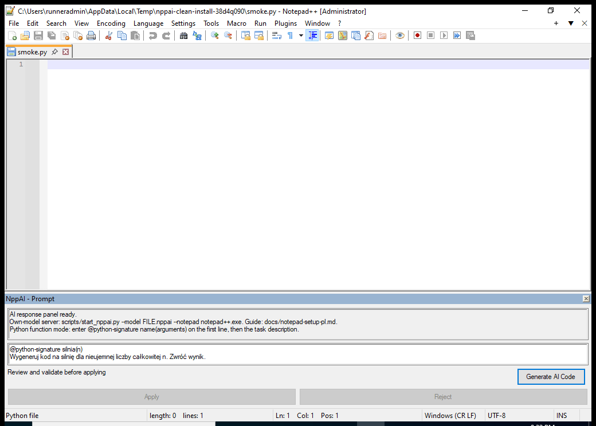

# Real released-plugin generation demonstration

The `Released plugin live generation demo` workflow uses the actual published
v0.5.0-rc.1 x64 plugin, service ZIP and unchanged research model. Each download
is checked against its published SHA-256, as is official portable Notepad++
8.9.8.1. The service starts from the extracted ZIP without a repository fallback.

It opens a fresh disposable editor, types a Polish factorial request, sends the
real Generate command, and waits for the plugin's proposal/validation review.
The test requires an actual HTTP 200 model response in the service log. It retains
the task, time-stamped UI status/history events, final review and raw window GIF.
It extracts the empty-document insertion diff and parses its Python syntax with
`ast.parse`, without executing the proposal. Syntax validity is distinct from a
functional pass; the model's actual code and parse error are preserved.
Frames come from the real test editor; no model output is substituted and no
success captions are added. The GIF samples the live window about once a second.

Validation is deliberately unconfigured in this demonstration. Apply must remain
disabled throughout. The model response is never executed or applied to the
editor. This demonstrates a working connection, visible model output and safe
review behavior, **not successful factorial generation or functional validation**.
The checkpoint's retained functional score remains 0/12.

Download `nppai-released-live-demo` from the workflow run to inspect the GIF,
report, event trace and service log. A service failure, missing real response,
review timeout, unavailable screen capture or enabled Apply fails the workflow;
those failures are not relabeled as model success.

## Observed release behavior, 19 October 2026

[Measured run 39320118532](https://github.com/deser1/NppAI/actions/runs/39320118532)
received a real model response and reached review with Apply disabled. The actual
insertion was `def silnia(n):` followed by invalid model text; AST parsing failed
at line 3 (`unmatched ')'`). No generated program was executed or applied.
The signature was supplied by the application, not learned by the model.

The recording also exposed a display bug: the released Win32 history control
collapses LF-only diff lines. The current fix normalizes display text to CRLF,
without changing the actual model response or patch. Native control tests and
current-package recording check the corrected path separately.

Historical release recording (shows the display defect, not successful code):

[Raw report](evidence/released-demo/report.json),
[UI event trace](evidence/released-demo/generation-events.json),
[service log](evidence/released-demo/server.log) and
[source/file hashes](evidence/released-demo/manifest.json) are retained in Git.
